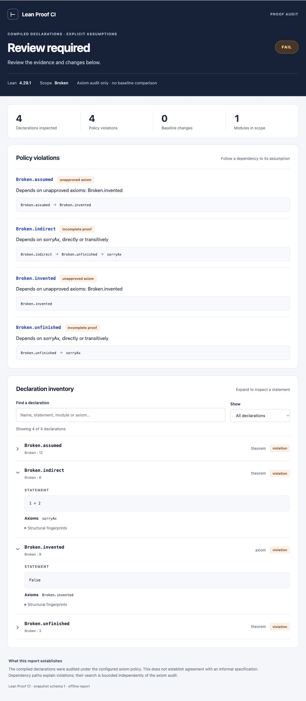

# Lean Proof CI

A small CLI for auditing Lean declarations and reviewing changes to their statements.
It checks compiled declarations, including transitive axiom dependencies, and produces
JSON, Markdown, and searchable offline HTML reports. Python 3.11+, with no Python runtime dependencies.

[日本語のクイックスタート](README.ja.md) · [Contributing](CONTRIBUTING.md) · [MIT license](LICENSE)

## New in 0.2

- See a dependency path from a failing theorem to `sorryAx` or an unapproved axiom.
- Compare against a baseline stored in a Git commit, even if the working copy was rewritten.
- Search and filter declarations, expand their statements, and inspect before/after changes
  in a single offline HTML file.
- Use this repository directly as a GitHub Action, including pass/fail outputs and a job summary.



## Try it

Install [elan](https://github.com/leanprover/elan#installation), then run from this checkout:

```sh
python3 -m lean_proof_ci check examples/basic \
  --baseline examples/basic/lean-proof-ci.baseline.json
```

The example pins **Lean 4.29.1**, the tested version. Elan will download it if necessary.
It imports only Lean's bundled libraries: no Mathlib download and no AI service are needed.
The `lake` command must be on `PATH`.

Expected output:

```text
PASS: 4 declarations, 0 policy violations, 0 baseline changes
```

Reports appear in `examples/basic/.proof-ci/report.json`, `report.md`, and `report.html`.
Open the HTML file directly in a browser; it needs no server or network connection.
Try the intentionally broken project as well:

```sh
python3 -m lean_proof_ci check examples/broken
```

It builds in Lean but this audit **exits 1**: a theorem depends on `sorryAx`, and
another theorem depends on an unapproved axiom. This is an expected failure.
The report shows paths such as `Broken.indirect → Broken.unfinished → sorryAx`.

To install the command locally, inside a Python virtual environment:

```sh
python3 -m pip install .
lean-proof-ci --help
```

The project is not published to PyPI; install from this checkout or its built wheel.

## What fails CI?

| Condition | Result |
| --- | --- |
| Direct or transitive dependency on `sorryAx` | Failure; cannot be allowlisted |
| Dependency on an axiom outside the configured allowlist | Failure |
| Changed theorem type, including added assumptions | Failure against a baseline |
| Changed definition/opaque body | Failure against a baseline |
| Removed declaration, changed kind/module, or changed axiom footprint | Failure against a baseline |
| Changed roots, axiom policy, Lean version, or dependency manifest | Failure against a baseline |
| New declaration with an acceptable axiom footprint | Informational change; passes |
| Proof-only edit with the same statement and axiom footprint | Passes |
| Binder variable renamed, or formatting/comments changed | Passes when compiled structure is unchanged |
| Build/inspection failure, timeout, invalid baseline, or empty audit | Operational error; never passes |

Exit codes: **0** pass, **1** policy or baseline failure, **2** operational/configuration error.
The JSON report has `status`, `snapshot`, `findings`, and `changes`; operational errors
also include `error`. Each change records whether it fails CI. A check without either
`--baseline` or `--baseline-ref` audits axioms only and explicitly reports that comparison was not requested.

## Audit your project

Create `lean-proof-ci.toml` alongside its `lakefile.toml` or `lakefile.lean`:

```toml
modules = ["MyLibrary"]
allowed_axioms = ["propext", "Classical.choice", "Quot.sound"]
timeout_seconds = 180
```

`modules` specifies **import roots**, not declaration namespaces. A root `MyLibrary`
audits declarations in `MyLibrary` and its *imported* `MyLibrary.*` modules. A theorem
declared in an unrelated namespace inside those files is still audited. Include other
roots explicitly if their declarations should also be inventoried. Unimported files
are outside the audit; keep your library's root imports complete.

Every selected declaration is inventoried, including definitions, axioms, private
declarations, and compiler-generated declarations visible in the imported environment.
Axiom dependencies are followed through **all imported modules**, including dependencies
outside the inventory scope. This catches an external helper containing `sorry` when a
selected declaration uses that helper.

For a new project, establish a baseline after reviewing the statements and axiom policy:

```sh
lean-proof-ci snapshot /path/to/project
lean-proof-ci check /path/to/project \
  --baseline /path/to/project/lean-proof-ci.baseline.json
```

`snapshot` writes `lean-proof-ci.baseline.json` only after the axiom audit passes.
Commit the baseline, the config, `lean-toolchain`, and `lake-manifest.json`.
Run `snapshot` again only when a reviewer intentionally accepts the reported changes.
Do not regenerate the baseline automatically in the same CI job that checks it.

Optional arguments:

```sh
lean-proof-ci check /path/to/project \
  --module MyLibrary --module OtherRoot \
  --baseline reviewed.json \
  --timeout 300 \
  --json artifacts/audit.json \
  --markdown artifacts/audit.md \
  --html artifacts/audit.html
```

Explicit file paths are relative to the current working directory. Default config,
snapshot, and report paths are relative to the project. `--module` replaces configured
roots. Timeout applies separately to the build command and inspection command.

## Compare against a Git baseline

```sh
lean-proof-ci check examples/basic --baseline-ref origin/main
```

The tool resolves the ref to a commit and reads the baseline from that Git object without
checking it out. By default, it reads `PROJECT/lean-proof-ci.baseline.json` relative to
the Git root. Use `--baseline-path path/in/repository.json` to select a different path.
An unknown ref or absent/invalid historical file is an error; the tool never falls back
to the working copy. `--baseline` and `--baseline-ref` are mutually exclusive.

The JSON report records the resolved commit, ref, and repository path under `baseline_source`.
This makes the comparison reproducible and prevents a PR from hiding changes merely by
updating its own baseline file. Fetch the base commit first (for GitHub Actions, use
`actions/checkout` with `fetch-depth: 0`).

Intentional statement/definition changes still fail when compared with the PR base. A
maintainer must review those changes and decide whether to accept them; regenerating
the working baseline alone does not make this stricter check pass. Protect the workflow
and checker version as well: reading a Git baseline is not a sandbox or an authentication mechanism.

## GitHub Actions

The reusable [action.yml](action.yml) installs Python and the checker. Set up the target
project's Lean toolchain separately. Here is a complete PR workflow for a Lake project
at the repository root:

```yaml
name: Proof audit
on: pull_request
permissions:
  contents: read
jobs:
  audit:
    runs-on: ubuntu-latest
    steps:
      - uses: actions/checkout@v4
        with:
          fetch-depth: 0
      - uses: leanprover/lean-action@v1
        with:
          auto-config: false
      - uses: nktkt/lean-proof-ci@v0.2.0
        id: proof
        with:
          project: .
          baseline-ref: ${{ github.event.pull_request.base.sha }}
      - uses: actions/upload-artifact@v4
        if: always()
        with:
          name: proof-audit
          path: .proof-ci/
          include-hidden-files: true
```

Pin the action to a reviewed commit SHA if you require immutable action code. Inputs
are `project`, `baseline`, `baseline-ref`, `baseline-path`, `report-directory`, and `timeout`.
Without either baseline input, the action runs an axiom-only audit. Outputs include
`status`, `exit-code`, `json-report`, `markdown-report`, and `html-report`. It fails the
step for exit 1 or 2, while still appending any generated Markdown report to the job summary.

This repository's own [.github/workflows/ci.yml](.github/workflows/ci.yml) runs the test
suite, invokes the action on the valid example, and checks that the intentionally broken
example produces exit 1. On PRs it uses the base commit's baseline. The expected failure
step uses `continue-on-error` only for this test; do not use it for a real audit gate.

Treat baseline/config changes as reviewable code changes. For untrusted pull requests,
use ordinary `pull_request` workflows without secrets or write tokens. Lake and Lean can
execute project code; this tool is not a sandbox. A PR that can change the checker,
workflow, and its own baseline can change what the check means.

## How it works

1. Build the selected roots with `lake build +Root ...` using the project's toolchain.
2. Run a temporary Lean inspector through `lake env lean`.
3. Inspect the compiled environment and use Lean's `collectAxioms` for each declaration.
4. Hash a structured encoding of the elaborated type. Strip binder names and source
   metadata, while retaining binders, implicitness, constants, universe levels, and arguments.
5. Track definition/opaque bodies separately, then compare with the reviewed snapshot.

For rejected axioms, the inspector also searches the same kernel dependency relation
for one shortest explanation path. This search is limited to 20,000 visited declarations
per audited declaration. A missing explanation does not suppress the axiom violation.

The inspector is bundled in the Python wheel. It adds no dependency to your Lake project.
Temporary files are removed after inspection; normal Lake build outputs remain.

## Scope and limitations

- Tested on Lean **4.29.1**, macOS/Python 3.14 and Linux/Python 3.11.
  Other Lean versions may need an inspector update. Version mismatches against a baseline
  are surfaced for review rather than silently ignored.
- This is an audit of Lean's compiled environment, not an independent kernel checker or
  proof of agreement with an English/Japanese specification. It trusts the Lean toolchain,
  build artifacts, imports, and execution environment. It does not recheck cached `.olean`
  files with an independent checker.
- `native_decide`-style compiler-trust axioms are rejected by the default three-axiom
  policy when they appear in the dependency footprint.
- An anonymous `example` does not necessarily persist as a declaration and is not covered.
  Neither are unimported source files or unused declarations outside the configured roots.
- Fingerprints compare structure, not logical equivalence. Equivalent reformulations or
  changes to compiler-generated/private names can require review. Public theorem proof
  bodies themselves are not fingerprinted.
- Definition bodies within the selected scope are tracked. Changes inside external
  libraries are only signaled by their manifest/toolchain changes and affected axiom
  footprints; editing an untracked path dependency may evade this comparison. Include
  relevant local dependency roots and keep external dependencies pinned.
- Import roots currently use ASCII dotted identifiers; declaration names and report
  statements may contain Unicode. Large Mathlib/Stacks projects have not been benchmarked.

See Lean's [axiom documentation](https://lean-lang.org/doc/reference/latest/Axioms/) for
the meaning of the allowlist. Existing tools such as
[lean-action](https://github.com/leanprover/lean-action) already provide axiom-audit and
independent checking integrations. This tool focuses on a portable CLI, explicit module
scope, and reviewable statement/definition snapshots alongside the axiom audit.

Version 0.2 adds optional `axiom_paths` to schema-1 snapshots and keeps the existing
fingerprints unchanged. Version 0.1 baselines remain readable; do not regenerate a reviewed
baseline just to upgrade the checker. The HTML word diff is for display only; all decisions
continue to use the structural fingerprints.

## Source-to-Lean correspondence reviews

**ProofReview** links a local informal specification to a Lean declaration and records
who compared their meaning. Each record is bound to the source text, mapping,
elaborated statement, reachable in-scope definitions, and inspection environment.
Changes make the affected reviews stale. Mechanical audit results and correspondence
reviews are reported separately; this does not automatically prove semantic equivalence.

Try the isolated walkthrough (synthetic records, clearly labeled as automated):

```sh
python3 examples/review_demo.py
```

It demonstrates pending reviews, current records, and a definition change that expires
only the related review, using a copy under `.proof-ci/`. To inspect the real example:

```sh
lean-proof-ci review examples/basic
```

Initially this exits **1** because its three items have not been reviewed. Read
`examples/basic/.proof-ci/review.md`, compare the source/statement and definitions, then
record an individual review explicitly:

```sh
lean-proof-ci accept examples/basic --item twice \
  --reviewer "Reviewer name" --note "Compared the quantifiers, definition, assumptions, and conclusion."
```

`accept` rebuilds and inspects the project and refuses policy violations. Its exit **0**
means that one record was saved; other items may still be pending. Use `review` as the
CI gate: it exits **0** only when the mechanical audit passes and every configured item
is current, **1** for outstanding reviews/policy violations, and **2** for operational errors.
Commit `lean-proof-review.toml`, the local source files, and `lean-proof-review.json`.
Run only `review` in the real project's CI, not automatic acceptance.

Review coverage is opt-in through the manifest. Records are self-reported and are not
authenticated signatures. External definitions are covered by the toolchain/lockfile,
so include relevant local dependencies in the configured roots. Datatype changes in the
scope conservatively expire all records. See the
[Japanese ProofReview guide](PROOFREVIEW.ja.md) for configuration, states, and limitations.

## Develop

```sh
python3 -m unittest discover -v
uv build
```

Tests invoke a real Lean compiler. A missing compiler fails the suite instead of skipping
its main checks. See [CONTRIBUTING.md](CONTRIBUTING.md) for the expected review workflow.
